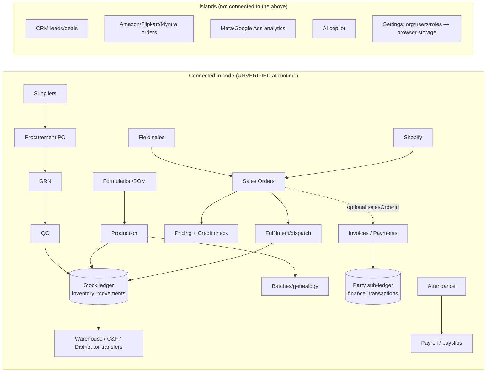
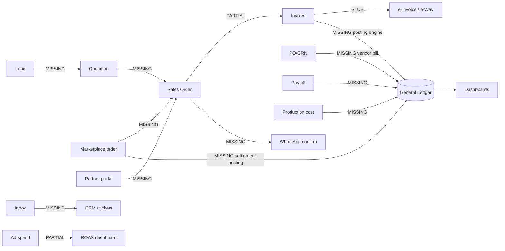

# 03 — Module Interconnection (Step 4)

Method: followed the code from the first step of each flow to the last (service calls and SQL), using file/function names as evidence. "Breaks at" = the first link I could not find in code. Nothing was executed.

**Big picture:** the *operations → stock* chain is genuinely wired (purchasing, production, transfers, fulfilment, returns all write the same stock ledger). The *money* chain is not: invoices and payments update a customer sub-ledger, but there are **no ledger accounts and no journal posting**, so purchasing, stock, payroll and marketplaces never reach "Accounts". There is **no event bus**; modules call each other directly or share tables.

## Flow 1 — Lead → Quotation → Sales Order → Invoice → Payment → Ledger → Dashboard
| Step | Real? | Evidence |
|---|---|---|
| Lead → Deal (CRM) | yes | `crm-service.ts convertLead :413` (marks lead converted) |
| Lead/Deal → Customer master | UNVERIFIED | convertLead updates CRM tables; no link to distributor/retailer/customer master found |
| Quotation | **missing** | no sales-quotation tables/service (search) |
| Sales Order (pricing, credit, reservation) | yes | `sales-order-service.ts` → `pricing-service`, `credit-service`, `fulfillment-service` |
| Dispatch → stock deduction | yes | `fulfillment-service.ts` → `inventory-service` |
| Invoice | partial | `FinanceService.createInvoice({salesOrderId?})` exists; **no automatic SO→invoice conversion found**; invoice-preparation builds a "handoff payload" (`sales-order-routes.ts:331`) |
| E-invoice / e-way bill | **stub** | field only |
| Payment | yes | `payments`, `payment_allocations`; 5 `finance_transactions` insert sites |
| Ledger entries | **partial** | party ledger (debit/credit/running balance) only — no chart of accounts |
| Dashboard | partial | finance/command-center read the tables above; numbers unverified |
**Breaks at:** CRM→customer, Quotation, SO→Invoice automation, e-invoice, general ledger.

## Flow 2 — Purchase Order → GRN → Stock → Vendor bill → Payment
| Step | Real? | Evidence |
|---|---|---|
| PR → PO | yes | `procurement-service.ts`, `purchase_requests/orders` |
| GRN → QC → stock posting | **yes** | `procurement-service.ts ~1369-1650` (comment "Creates immutable inventory_movements"; `SELECT … FOR UPDATE` on `inventory_balances`; `grn.inventory_posted`) |
| Vendor bill / purchase invoice | **missing** | no purchase-invoice table in `01b` (search) |
| Payment to supplier | **missing** | finance payments are customer-side; supplier payment not found |
| Accounting entry | **missing** | |
**Breaks at:** vendor bill → payment → ledger (also 3-way match, RFQ).

## Flow 3 — Production order → Raw material consumption → FG batch → Stock
| Step | Real? | Evidence |
|---|---|---|
| Formulation/BOM → work order | yes | `formulation-service`, `production-service` |
| Material availability / reservation / issue | yes | `production-service.ts :797-1071` (`inventory_balances`, `stock_reservations`) |
| QC gate | yes | `production-service` → `quality-service` |
| FG batch + genealogy | yes | `batch-service.ts` |
| FG receipt to stock | yes | `inventory_movements` insert helper `:54-78` |
| Cost → accounting | **missing** | no GL |
| Planning (MRP / demand) | **missing** | |
**Breaks at:** planning upstream and costing/accounting downstream; the middle is the best-connected flow in the app.

## Flow 4 — Partner / field-staff order → Sales Order → Invoice → WhatsApp confirmation
| Step | Real? | Evidence |
|---|---|---|
| Field-staff order → SO | yes | `field-sales-service.ts :1096 SalesOrderService.createOrder` |
| Distributor/retailer portal order | **missing** | no partner login (UI is staff-only); retailer "order requests" exist internally (`retailer_order_request_items`) |
| SO → Invoice | partial | as Flow 1 |
| WhatsApp confirmation | **missing** | settings card only |
**Breaks at:** partner portal, invoice automation, WhatsApp.

## Flow 5 — Attendance → Payroll → Accounting
| Step | Real? | Evidence |
|---|---|---|
| Attendance → payroll run | yes | `hrms-payroll-service.ts :340-345` reads attendance counts |
| Payslips, statutory deductions | yes (some wrong) | `:365-400` PF/ESI ok; PT flat ₹200; TDS manual |
| Payroll → accounting entries | **missing** | no reference to finance in payroll service |
| Sales achievement → incentive → payroll | **missing** | |
**Breaks at:** accounting posting, incentives, statutory filings.

## Flow 6 — E-commerce order → Stock → Invoice → Settlement
| Provider | Order lands in | Stock/Invoice | Settlement |
|---|---|---|---|
| Shopify | **`sales_orders`** (`shopify-service.ts :495`) | stock deduction via normal SO flow (UNVERIFIED) | not found |
| Amazon / Flipkart / Myntra | only `marketplace_orders` (own tables) — **no conversion to `sales_orders` found** | none | `marketplace_settlements` stored (e.g. `migrate-amazon.ts:878`), **no posting to accounts**, no fee/TCS/commission breakdown posting |
Also: marketplace sessions can be simulated (`amazon-client.ts:71,101`, `flipkart-client.ts:60`), so "orders" in dashboards may be seed/demo rows (`migrate-amazon.ts:783`, `migrate-flipkart.ts:660`, `migrate-myntra.ts:373` insert orders).
**Breaks at:** marketplace order → internal order, invoice, settlement reconciliation.

## Diagram — what is really connected today

## Diagram — intended (PRD §6) vs missing links

**One-line conclusion:** the stock side of the business is wired; the accounting, compliance, partner-facing and messaging sides are not.
